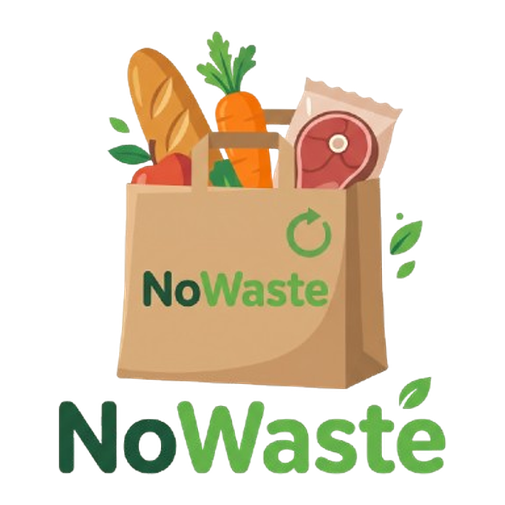

# NoWaste

Mobile Development Project.

NoWaste is een Android-app tegen voedselverspilling. Handelaars bieden hun overschotten van de dag aan als verrassingspakket aan een lage prijs. Klanten zoeken pakketten in de buurt via een lijst of kaart, reserveren er een en halen het op met een ophaalcode binnen een vast tijdsvenster.

Gebouwd met Kotlin, Jetpack Compose, Firebase, Room en OSMDroid.

**[Planning](Documentation/planning.md)** · [UI](UI/UI.md)

Created by Neagu Sergiu!\
CO-Owned by Laurens Rombout!\
Year: 2026-2027\
School: AP Hogeschool
