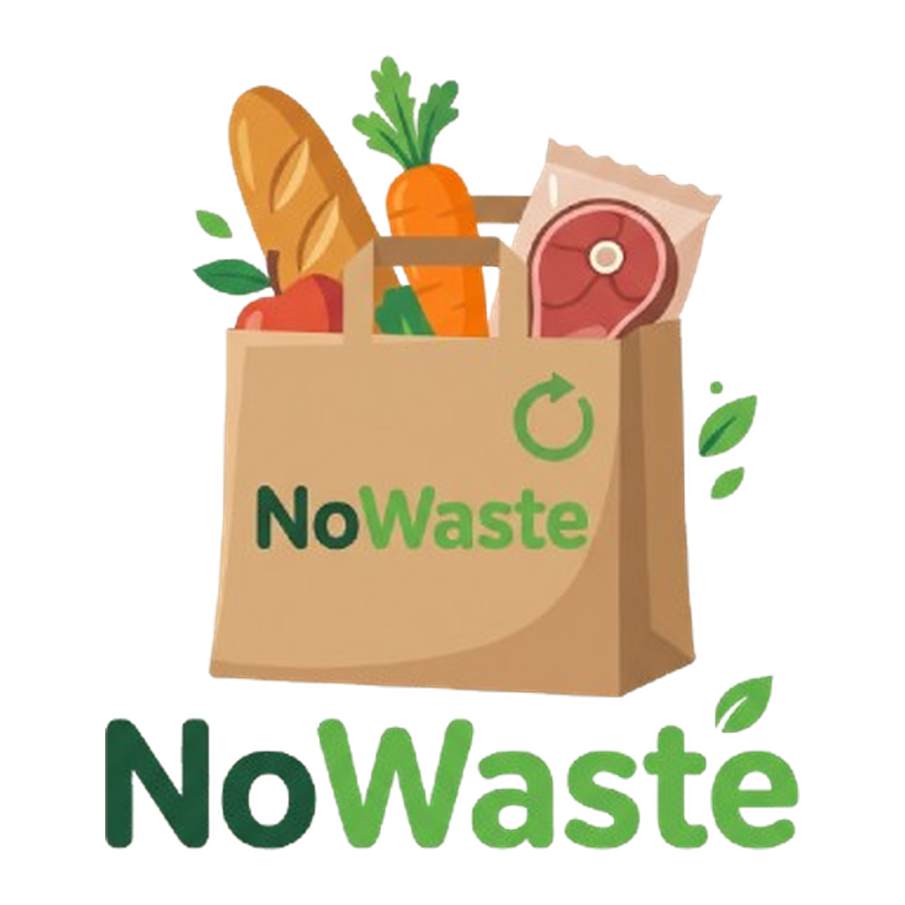

# NoWaste



Mobile Development Project.

NoWaste is een Android-app tegen voedselverspilling. Handelaars bieden hun overschotten van de dag aan als verrassingspakket aan een lage prijs. Klanten zoeken pakketten in de buurt via een lijst of kaart, reserveren er een en halen het op met een ophaalcode binnen een vast tijdsvenster.

Gebouwd met Kotlin, Jetpack Compose, Firebase, Room en OSMDroid.

**[Planning](Documentation/planning.md)** · [UI](UI/UI.md)

## Team

**Team 03**

| Naam | Rol |
|---|---|
| Neagu Sergiu | Account en handelaar (A1–A4, H1–H7) |
| Laurens Rombout | Klant (K1–K12) |

## Installatie

1. Installeer Android Studio (met Android SDK 37).
2. Open de projectmap in Android Studio. `local.properties` met het SDK-pad wordt automatisch aangemaakt.
3. Bouw en start de app met de knop Run, of in een terminal:

   ```bash
   ./gradlew installDebug   # Windows: gradlew.bat installDebug
   ```

Alle commando's staan in [werkafspraken.md](Documentation/werkafspraken.md#commandos).

## Testdata

`tools/seed-firestore.ps1` vult Firestore met 10 testwinkels rond AP Hogeschool en hun pakketten, zodat de klantschermen data hebben voor een demo. Het script maakt per winkel een handelaarsaccount (`demo-<sleutel>@nowaste.test`, bv. `demo-bakery`, `demo-cafe2`) en schrijft als die handelaar, dus de security rules gelden gewoon. Daarnaast maakt het een klantaccount `demo-customer@nowaste.test` om mee in te loggen. Drie pakketten mogen bij de klant **niet** verschijnen (uitverkocht, ophaalvenster voorbij, niet actief) om de filters te testen.

```powershell
.\tools\seed-firestore.ps1
# Ergens anders: -Latitude 51.0543 -Longitude 3.7174
```

Zonder `-Password` gebruikt het script `seed.password` uit `local.properties` (niet gecommit). Staat dat er nog niet, dan maakt het een wachtwoord aan en zet het daar. Elk teamlid heeft dus een eigen wachtwoord voor de demo-accounts op zijn machine: maakte de andere de accounts al aan, geef dan zijn wachtwoord mee met `-Password`.

De ophaalvensters starten vanaf het moment dat je het script uitvoert en de meeste pakketten blijven ongeveer 8 uur beschikbaar. Voer het script uit op de dag van de demo. Opnieuw uitvoeren kan veilig, dezelfde documenten worden overschreven. Ook de aantallen staan dan terug op hun beginwaarde, ook als er tijdens het testen pakketten gereserveerd werden. De testreservaties zelf blijven in Firestore staan.

Inloggen als demo-klant op een toestel via USB zonder het wachtwoord over te typen: tik in de app op het veld Email en voer dan dit uit in de projectmap.

```powershell
$adb="$env:LOCALAPPDATA\Android\Sdk\platform-tools\adb.exe"; $pw=((Select-String -Path local.properties -Pattern '^seed\.password=(.*)$').Matches[0].Groups[1].Value); & $adb shell input text "demo-customer@nowaste.test"; & $adb shell input keyevent 61; & $adb shell input text $pw; & $adb shell input keyevent 66
```

## Projectstructuur

| Map | Inhoud |
|---|---|
| `app/src/main/java/be/ap/nowaste/ui/theme` | Kleuren en Material-thema (light en dark) |
| `app/src/main/java/be/ap/nowaste/ui/navigation` | Routes en bottom navigation |
| `app/src/main/java/be/ap/nowaste/ui/<scherm>` | Per scherm de composable en de ViewModel |
| `gradle/libs.versions.toml` | Versies van alle dependencies |

Created by Neagu Sergiu!\
CO-Owned by Laurens Rombout!\
Year: 2026-2027\
School: AP Hogeschool
